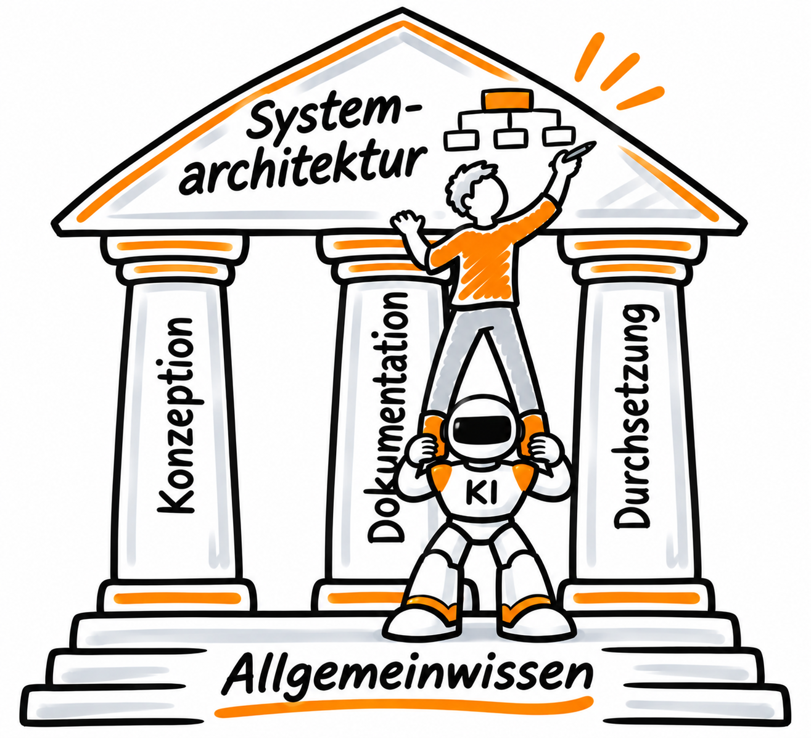

:toc:
:author: Jan Leßner, Luca Pieprzyk

# Kollegin KI und die Architektur

Auch bei der Architekturarbeit ist KI eine wertvolle Hilfe. Wer aber primär auf einen _Zeitgewinn_ schaut, der genießt vielleicht eine anfängliche Superbeschleunigung, klatscht aber umso schneller unkontrolliert gegen eine Wand aus massiver Unwartbarkeit. Mit dem primären Ziel _Qualitätsgewinn_ und dem Lenkrad in den eigenen Händen fährt es sich dagegen deutlich kontrollierter und am Ende flotter.

## Einleitung

Nevio: _"Was ist das für ein Konzept? Was soll das??"_ +
Jannik: _"Wieso Konzept? Das ist KI."_ +
Aus "Die Burg", Hörbuchfassung, Ursula Poznanski, 2024

Dieser kleine Dialog könnte passender nicht beschreiben, was derzeit die Diskussion über die Rolle von Künstlicher Intelligenz (KI) in der Softwareentwicklung und der Software-Architektur prägt. Er beschreibt auch eine Erkenntnis, die sich trotz der rasanten Evolution von KI-Agenten im Kern nicht ändert: Ein LLM ist eine ultrahochentwickelte Pattern-Matching-Maschine, die hervorragend darin ist, Muster und Konzepte zu erkennen und ihnen zu folgen. Das *Erfinden* von Konzepten liegt aber nicht in ihrer Kernkompetenz. Überlässt man ihr diese Aufgabe, ist das quasi eine Einladung zum "Halluzinieren", und die Trefferquote für projektgeeignete Ergebnisse ist zufällig. Zufall ist aber ein bisschen dünn für architektonische Konzepte, die auch KI-unterstützt nach hinten raus teuer zu ändern sind.

Mit "Architekturarbeit" sind in diesem Artikel die Aspekte gemeint, bei denen das Team selbst Hand anlegt. Für den Bau eines neuen Teilsystems gibt die Makroebene beispielsweise vor, dass die Kommunikation mit anderen Systemen asynchron über JMS läuft und die Daten in einem alten DB2-Schätzchen liegen, weil nur dafür Lizenzen und ausgebildete Admins verfügbar sind. Zwischen diesen Vorgaben und konkretem Anwendungscode klafft aber noch eine breite Lücke an Entscheidungen, die das Team selbst treffen muss, damit der Code hinterher elegant, wartbar und erweiterbar ist. Hier gibt es kein allgemeingültig "richtig" oder "falsch", nichts in Stein gemeißeltes und viel subjektiven Team-Spirit.

Wenn das Teilsystem z.B. eine Absicherung gegen konkurrierende Zugriffe braucht: macht man das dann mit Optimistic Locking und Basisklassen für alle zukünftigen Entitäten und Repositories? Sind später Ausnahmen absehbar? Passt das zu den nicht-funktionalen _fachlichen_ Anforderungen? Das Team muss recherchieren, Erfahrung einbringen, diskutieren, im Mob-Programming ausprobieren und Beschlüsse fassen. Das klingt nach Vorgängen, die KI nicht leisten, nur unterstützen kann.

Die im Folgenden geschilderten Erfahrungen stammen übrigens aus Systemen der Bilanzanalyse mit einigen Hunderttausend Zeilen nicht-trivialen Codes, betreut von typischen 2-Pizza-Teams. Vibe-Coding mit nur ungefähr vorhersagbaren Ergebnissen ist hier fehl am Platze.

## Architektur _von_ der KI?
Können wir nicht einfach ein Team von KI-Agenten auf die Architektur ansetzen und das lästige Menschenteam aus der Verantwortung nehmen?

Eher nicht. Zu viele Faktoren gehen in die Konzeption ein, und großteils sind sie _unausgesprochen_ und damit einem Agenten kaum vermittelbar. Der _allgemeine_ Wissensschatz einer KI über alle je dagewesenen Architektur- und Designpatterns ist riesig. Den sollte man tunlichst auch nutzen! Das _projektspezifische_ Wissen ist aber zunächst gleich 0, und für dessen Vermittlung steht maximal der Konversationskontext zur Verfügung. Der ist winzig im Vergleich zu dem, was menschliche Entwickler einbringen: Jahre an Erfahrungshistorie, jahrzehntelange Sozialisierung und viel "Zwischen-den-Zeilen-Wissen" passen nicht ansatzweise in die aktuell üblichen 1 Million Kontexttokens. Fehlen solche Informationen bei Menschen (Projekt unbekannt, keine Berufserfahrung, andere Arbeitskultur), kommen häufig unbrauchbare Konzepte aus dem Elfenbeinturm heraus. Genau das ist auch von KI-entworfener Architektur zu erwarten. Da hilft es auch nicht, wenn der Entwurf 100 Mal schneller fertig ist. Eine schlechte Entscheidung bleibt schlecht, egal wie schnell sie zustande kam.

## Architektur _mit_ der KI
Konzepte, Bewertung und Verantwortung müssen also weiter von Menschen kommen. Eine Aussage der Art

_"Keine Ahnung - hat Claude so gemacht."_

ist nicht akzeptabel und ein Alarmsignal für einsetzenden Kontrollverlust. Es wäre aber eine Schande, das enorme Allgemeinwissen der KI zu Programmiersprachen, Paradigmen und Designpatterns nicht in allen Phasen der Architekturarbeit zu nutzen: von der Konzeption über die Dokumentation bis zur Durchsetzung.

Was eine _menschliche_ Architekturentscheidung häufig schlecht macht, lässt sich mithilfe von KI zum Teil gut abfangen.

### Unbekannte Unbekannte
Das meiste Wissen ist jenes, von dem wir nicht wissen, dass wir es nicht wissen [NNT]. Solche Lücken lassen sich nicht gezielt schließen, weil sie uns gar nicht bewusst sind. Kollaborative Lernformen wie Coding Dojos helfen, sie über den Erfahrungsschatz anderer zu erkennen. Hier kann die KI ein neuer Sparringspartner sein, der aus seinem Allgemeinwissen heraus Vorschläge macht und für Inspiration sorgt.

Wer im Beispiel aus der Einleitung nur weiß, dass er irgendwie konkurrierende Zugriffe absichern muss, aber von "Optimistic Locking" noch nie gehört hat, der schildert einem Agenten möglichst ausführlich die Herausforderung: bekannte Details, eigene Ideen, Randbedingungen. Wo sich ein menschlicher Sparringspartner eher überfordert fühlt, sorgt das bei einem Agenten für gezieltere, gut erklärte Ergebnisse. Ausführlichkeit zwingt außerdem dazu, die Frage präzise zu formulieren und zu verifizieren, ob einem die _Problemstellung_ hundertprozentig klar ist. Das ist eine wichtige Voraussetzung für einen späteren ADR (Architecture Decision Record). Der Vorgang des präzisen Formulierens ist übrigens ein erklecklicher Teil eines guten Entwurfsprozesses.

*JA, richtig gelesen!* +
Die Architekturdokumentation wird mit der Nutzung von KI wieder wichtiger denn je. Dazu später mehr.

### Lieblingslösungen

Menschen klammern sich bei Richtungsentscheidungen gern an Lieblingslösungen. Das ist nicht per se schlecht, denn gute Erfahrungen zählen. Problematisch wird es, wenn die Lösung nicht optimal passt - sei es technisch oder organisatorisch bedingt. KI hat hingegen keine "Lieblinge" und macht daher neutralere Vorschläge, allerdings prinzipbedingt mit der Tendenz zu Standardlösungen. Das ist aber nicht schlimm, sondern hilft bei einer anderen Quelle menschlicher Fehlentscheidungen...

### Inneres Kolloquium
Ihren Lieblingslösungen gegenüber neigen Menschen zur Alternativen-Blindheit und scheuen mitunter die Diskussion mit Kollegen. Hat mich aber ein KI-Agent auf eine Alternative aufmerksam gemacht, kann ich meinen Favoriten erstmal ihm gegenüber mit Argumenten verteidigen. Es ist egal, über wie viele Runden dieses innere Kolloquium geht und ob am Ende ein Dissens bleibt: Der Agent ist unermüdlich und hinterher nicht beleidigt. Ob ich bei meinem Favoriten bleibe oder mich überzeugen lasse - das "Warum" für meine menschlichen Kollegen und den ADR ist mit Sicherheit gut geschärft.

Wichtig ist, der KI für diese Phase explizit eine kritische Haltung einzuprompten. Sie neigt sonst zur Bestätigung von Vorlieben. Das ist auch deshalb wichtig, weil Agenten später weitgehend kritiklos den vereinbarten Konzepten folgen. Sie verdrehen nicht mitten im Pair Programming die Augen und antworten auf einen Prompt:

_"Mir rollen sich jedes Mal die Fußnägel hoch, wenn wir ..."._

Schwachen Konzepten folgen sie leider genauso konsequent wie guten.

### Gegenlesen
Ein ausgearbeitetes Konzept kann KI oft gut auf Konsistenz prüfen, bevor man in die Umsetzung geht. Voraussetzung ist, dass es irgendwo klar beschrieben ist, was wieder zur Architekturdokumentation führt. Sie muss für Mensch und Maschine gleichermaßen zugänglich sein.

Spannend ist das Gegenlesen auch, wenn ein neues Konzept in eine _bestehende_ Software eingeführt werden soll. Die KI kann den Code wesentlich schneller als Menschen darauf untersuchen, ob er sich mit dem Konzept verträgt. Bezogen auf das Beispiel vom Anfang: auf der "grünen Wiese" mag Optimistic Locking unproblematisch sein. Bei einem Bestandsprojekt stellt man aber vielleicht fest, dass es eine Tabelle mit Milliarden von Datensätzen gibt, die nur über Massenoperationen beschickt wird. Optimistic Locking auf Einzelsatzebene ist hier nicht praktikabel.

Die Dokumentation muss auch für jene Agenten jederzeit abrufbar sein, die später implementieren. Wo sich Kollegen sonst mangels brauchbarer Doku in der Kaffeeküche absprechen und das Gesagte im Langzeitgedächtnis speichern, fängt eine KI täglich von vorn an. Ralf Klemmer hat Agenten auf seinem YouTube-Kanal mit "Betrunkenen Genies" verglichen [RKB]. Damit diese Genies nach durchzechter Nacht am nächsten Morgen mit Filmriss wieder auf Spur kommen, muss alles Wichtige sofort parat liegen.

Aber was heißt nun "parat liegen"?

## Architekturdoku
Wer bis hierhin den Eindruck hat

_"Das klingt aber irgendwie old-school, so mit Doku und selber Nachdenken"_

der liegt gar nicht so falsch. Klassische Werte eines stringenten Software-Engineerings werden durch KI nicht obsolet. Benedikt Stemmildt hat es im Podcast von Richard Seidl sehr schön auf den Punkt gebracht [BRB]:

[quote]
Wenn du schlechte Prinzipien hast und KI anwendest, wirst du schneller schlechter; wenn du gute Prinzipien hast, wirst du schneller besser, weil KI den vorhandenen Kurs einfach beschleunigt.

Was sich ändert, ist das Tooling, um die neue Kollegin KI mit ins Boot zu holen. Dass Architekturdokumentation maschinenzugänglich, aber trotzdem menschentauglich sein muss, ist aktuell eine noch wenig beachtete Herausforderung.

Die textuellen Teile solcher Dokumentationen entstanden traditionell mit WYSIWYG-Textprozessoren wie Microsoft Word, die für KI schlecht lesbar sind. Das Pendel schlägt deshalb gerade voll in die andere Richtung aus: Im Umfeld von Spec-driven Development sprießen Tools wie spec-kit [SKT] und OpenSpec [OSP] aus dem Boden, die auf Markdown setzen. Hier wird alles der Maschinenzugänglichkeit untergeordnet, und nun sind Lesbarkeit und Wartbarkeit durch den Menschen mangelhaft.

Das Open-Source-Spezifikationswerkzeug Specman [SMN] zeigt, wie es künftig alternativ aussehen könnte: strukturiertes WYSIWYG im UI, ein Pseudocode-artiges Dateiformat mit EBNF-Grammatik für optimale KI-Lesbarkeit, beides gekoppelt über ein CLI. Für Usecase-Spezifikationen ist das ein spannender Ansatz. Für Architekturdokumentation gibt es noch keine Entsprechung, und man muss sich ein wenig behelfen.

### Code als Doku

Genau wie bei menschlichen Entwicklern vermitteln nicht immer Dokumente allein ein Konzept. Oft sagen kleine Codebeispiele mehr als tausend Worte, und eine Pattern-Matching-Maschine kann damit erst recht viel anfangen.

Empfehlenswert sind isolierte "Referenzimplementierungen" mit zwei Eigenschaften:

- Sie sind so klein wie möglich, aber so groß wie nötig, um das Konzept schnell erfassbar zu vermitteln. Spätere _produktive_ Anwendungen dürfen umfangreicher und "schmutziger" sein - es gibt aber immer mindestens _ein_ sauberes, einfaches Beispiel.

- Sie liegen in einem echten Code-Repository, z.B. in separaten Packages oder Sourcefoldern neben dem Produktivcode. Kompiliert eine Referenz nicht mehr oder werden ihre Tests rot, fällt das sofort auf. Sie teilen sich mit dem Produktivcode Frameworks, Basisklassen, Qualitätsmetriken usw., sodass beide nicht schleichend auseinanderlaufen.

Das hilft auch, wenn Konzepte geändert werden müssen. Das probiert man dann nämlich erstmal nur an der Referenzimplementierung aus. Aus der Abwandlung kann ein KI-Agent anschließend mit etwas Hilfestellung die Abbildungsregeln vom alten auf das neue Konzept ableiten und die nervige mechanische Migration des Produktivcodes übernehmen. Die Grenze für die alte Regel, dass Architektur der schwer zu ändernde Teil einer Software ist, verschiebt sich also ein Stück. Zu viel Mühsal taugt seltener als Ausrede für das Festhalten an veralteten Konzepten.

### How-Tos und Skills
Schon lange vor KI-Agenten haben die Projekte, aus denen die hier beschriebenen Erfahrungen stammen, mit "How-To"-Dokumenten gearbeitet: kleinen, isolierten Dokumenten, die wiederkehrende technische Prozeduren beschreiben. Als Format hat sich dafür aus unterschiedlichen Gründen AsciiDoc [ASC] bewährt. Das Dokument `how-to-add-new-table.adoc` beschreibt beispielsweise alle Schritte, um eine neue Datenbanktabelle einzuführen:

- Erweiterung des Datenmodells
- Anlage einer Entity-Klasse, einer Datenbank-Adapterklasse und eines Repository
- Erweiterung von Exportskripten
- Bereitstellen eines Testdatenbuilders für Unittests
- Migrationsskript
- ...

Die How-Tos wurden ursprünglich nur von Entwicklern verwendet, wirken aber auch direkt wie ein Skill für einen KI-Agenten. Neue Tabellen lassen sich also mit dem Tabellen-How-To weitgehend automatisch anlegen.

Bei komplizierteren Prozeduren erfolgt eine Zweiteilung. Das How-To enthält Abläufe und Regeln für Mensch _und_ Maschine. Hinweise, die nur für einen Agenten relevant sind, liegen in einer separaten KI-Skill-Datei, die auf das How-To verweist und beliebig angereichert werden kann. Der Skill für eine umfangreiche Portierung eines UIs von GWT nach Vaadin enthält z.B. den Hinweis, die Arbeit in Runden aufzuteilen, weil sonst erfahrungsgemäß der Kontext überläuft und die KI auf halber Strecke anfängt rumzuspinnen.

ABBILDUNG: How-To und Skill-Datei (wird nach Annahme des Artikels nachgereicht)

Kontextüberläufe sind auch der Grund, warum für isolierte Aufgaben kleine isolierte Dokumente besser geeignet sind als Abschnitte in einem Zentraldokument.

How-Tos pflegt das Team gemeinschaftlich und redaktionell sauber, auch wenn die KI öfter bei der Aktualisierung hilft. Skill-Dateien sind hingegen eher "Sumpfgebiet": Hier darf die KI nach Belieben selbst schreiben, und sie gelten als ständig im Wandel, weil sich die Fähigkeiten der Agenten permanent ändern.

### Die zentrale Architekturdoku
Für alles, was nicht in den How-Tos steht, gibt es ein zentrales Architekturdokument: die ADRs, querschnittliche Konzepte wie Authentifizierung / Autorisierung, die Systemlandschaft, den Technologiestack, das Transaktionsmanagement, um einige Beispiele zu nennen. Wenn man es ernst nimmt, ist das ein recht umfangreiches Dokument mit vielen illustrierenden Abbildungen [A42]. Hier wird die Unterstützung für Mensch *und* Maschine schwierig:

- Ein größeres Dokument ist mit so simplen Mitteln wie AsciiDoc für Menschen mühsamer zu pflegen als mit komfortablen Textprozessoren. 10 Seiten sind in Ordnung, aber bei 50 Seiten und mehr stellt sich ein Gefühl von "Wrong tool for the job" ein. Selbst Tabellen und Kapitelreferenzen werden zur Herausforderung. Mit Markdown ist es noch schwieriger.

- Für die Abbildungen gibt es kaum bequeme Wege, sie direkt im Editor zu erstellen. Üblich ist ein breiter Kanon an Tools, z.B. UML-Tools für Diagramme, die üblicherweise als Screenshots eingebunden werden.

Perfekte Maschinenlesbarkeit also eher nicht. Das kann aber OK sein, wenn man die permanent benötigten Bestandteile wie die How-Tos separiert und die zentrale Doku auf die wesentlich seltener gebrauchten Aspekte beschränkt. Für die Einarbeitung neuer Team-Mitglieder ist sie beispielsweise enorm wichtig, aber das ist ein seltener Vorgang, bei dem gute Verständlichkeit für Menschen im Vordergrund steht. Erfahrene Mitglieder müssen meist nur ran, wenn ein Konzept geändert oder neu aufgenommen wird (siehe "Gegenlesen"). Wenn die KI dann für ihre Mitarbeit auch Bilder scannen muss, ist das nicht so schlimm.

Ärgerlich ist die Hürde allerdings, wenn die KI auch _direkt_ an der Doku mitarbeiten soll. Die Entstehung dieses Artikels selbst liefert ein Beispiel für das Problem. Er entstand in AsciiDoc, um von der direkten Mithilfe von GitHub Copilot beim Zu-Ende-Formulieren einzelner Sätze zu profitieren. Er ist klein genug dafür. Aber für das Einholen von Review-Kommentaren von Kolleginnen und Kollegen wurde das Dokument nach Microsoft Word exportiert, weil nur dort Änderungsmodus und Kommentarfunktion zur Verfügung stehen. Eine Form, die für Mensch _und_ Maschine gleichermaßen taugt, fehlt. Im Tooling steckt also noch richtig Potenzial.

## Durchsetzen der Architektur

Saubere Konzepte, sauber dokumentiert, also alles gut?

Es ist in der Tat beeindruckend, welche Produktivitätsgewinne sich auf der oben beschriebenen Grundlage in der Implementierungsarbeit realisieren lassen. Es entsteht ein ganz anderer Drive, wenn die KI einen Großteil der kanonischen Arbeit schultert, und der menschliche Entwickler sich viel besser auf die Kniffligkeiten konzentieren kann. Er wird zunehmend zum "Supervisor" und sollte einen Teil der gesparten Zeit in eine ganz neue dieser Kniffligkeiten investieren: darauf achten, dass sich das "betrunkene Genie" nicht mitten drin wie der Elefant im Porzellanladen aufführt. Mitunter kommt es nämlich schleichend oder plötzlich ohne ersichtlichen Grund zu einer Qualitätsdrift in der Arbeit der KI. Schlechte Vorbilder im Code oder zu volle Kontextfenster können z.B. dafür sorgen, dass Konzepte nur noch halbherzig Berücksichtigung finden, zumal die KI sie nicht wirklich "versteht", sondern nur nach Pattern-Matching-Prinzip befolgt.

Eine automatische Absicherung gegen solche Fälle sind "Leitplankentests". Sie zielen nicht auf die produktive Funktionalität ab, sondern auf die Einhaltung der eigenen Regeln des Software-Engineerings. Bei architektonischen Aspekten sind ArchUnit-Tests eine verbreitete Variante [AUT]. In die Build-Pipeline eingebettet, verhindern sie, dass regelverletzender Code überhaupt in Produktion gelangt. Außerdem können KI-Agenten sich anhand der Testergebnisse gleich selber korrigieren. Der Artikel "Leitplankentests" [JLL] gibt weitere Beispiele.

Wo weder programmierte Tests noch Qualitätsanalysen à la SonarQube greifen, kann wiederum die KI helfen. Mit sauberer, maschinenzugänglicher Architekturdokumentation lässt sich nämlich maschinell prüfen, ob der Code die dokumentierten Konzepte einhält und die Schritte der How-Tos befolgt wurden - egal, ob er von einem Agenten, einem Menschen oder einem Mensch-Agenten-Pair stammt. Da in diese Aufgabe viele Quellen eingehen, lohnt hier ganz besonders ein Blick auf die Kontextgrößen: Clustern von Dokumentation und Code sorgt für überschaubare Teilaufgaben. Auch die Einhaltung von Usecase-Spezifikationen und das Vorkommen von Logikfehlern lassen sich prüfen. Das entlastet die menschlichen Reviewer erheblich.

Warum dann überhaupt noch menschliche Reviews?

Weil niemand vorher weiß, wie weit sich Menschen und Agenten über die als selbstverständlich erachteten, undokumentierten Regeln einig sind. Der Strom unerwünscht kreativer Code-Ideen ist in neu aufgesetzten Projekten anfangs hoch und bricht auch in großen Projekten mit längerer KI-Nutzung nicht ab. Regelwerke und Leitplankentests wachsen deshalb anhand der Review-Findings kontinuierlich, um die Wahrscheinlichkeit von Wiederholungsfehlern zu senken. So entsteht eine Feedback-Schleife, die Architektur, Doku und Codequalität stetig verbessert. Verbesserung, die sich am Ende in Geschwindigkeit ohne Kontrollverlust auszahlt.

## Fazit

Eigentlich beruhigend, dass klassische Werte des Software-Engineerings durch KI-Einsatz eher bestätigt als abgelöst werden. Wer schon immer um saubere Konzepte bemüht war, wird die Qualitätsgewinne zu schätzen wissen. Die KI nimmt uns das Konzipieren nicht ab. Aber es ist ein gutes Gefühl, die grauen Zellen so richtig rauchen zu lassen, während die KI mit ihrem enormen Allgemeinwissen und ihrer Unermüdlichkeit unterstützt, Flüchtigkeitsfehler ausmerzt und - bildlich gesprochen - am Ende auch noch Fußleisten anbringt und durchfegt.

Zum Schluss nochmal zurück zu "Die Burg" von Ursula Poznanski, wo eine amoklaufende KI autonom einen Hightech-Escape-Room steuert. Zur Vollkatastrophe kommt es nur, weil die Kontrollsysteme, über welche die Game-Master das Geschehen überwachen, von genau der gleichen KI gesteuert werden. Eine völlig aberwitzige System-Architektur, die uns hoffentlich erspart bleibt, wenn Menschen ihre Kopfcomputer eingeschaltet lassen.

## Quellen
[NNT] Nassim Nicholas Taleb, Der Schwarze Schwan, 2007

[A42] arc42, Architektur-Dokumentation, https://arc42.org/

[RKB] Ralf Klemmer,
4 KI-Konzepte, https://www.youtube.com/watch?v=Xo0UxEu3NP4

[BRB] Richard Seidl / Benedikt Stemmildt, https://www.richard-seidl.com/de/podcast/agentic-engineering

[ASC] AsciiDoc Website, https://asciidoc.org/

[SKT] spec-kit Website, https://github.com/github/spec-kit

[OSP] OpenSpec Website, https://github.com/Fission-AI/OpenSpec

[SMN] Specman Website, https://specman.de

[JLL] Jan Leßner, Leitplankentests, iX-Sonderausgabe, https://www.heise.de/select/ix/2026/13/2605412445056705998

[AUT] ArchUnit-Tests, https://www.archunit.org/
