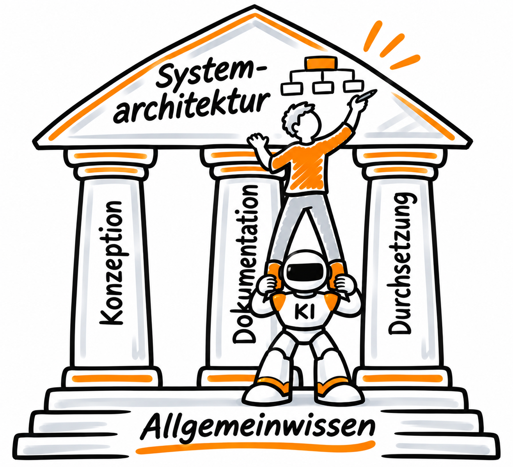

:toc:

# Kollege KI und die Architektur

Auch bei der Architekturarbeit ist KI eine wertvolle Hilfe. Wer aber primär auf einen _Zeitgewinn_ schaut, der genießt vielleicht eine anfängliche Superbeschleunigung, klatscht aber umso schneller unkontrolliert gegen eine Wand aus massiver Unwartbarkeit. Mit dem primären Ziel _Qualitätsgewinn_ und dem Lenkrad in den eigenen Händen fährt es sich dagegen deutlich kontrollierter und am Ende flotter.

## Einleitung

Nevio: _"Was ist das für ein Konzept? Was soll das??"_ +
Jannik: _"Wieso Konzept? Das ist KI."_ +
Aus "Die Burg", Hörbuchfassung, Ursula Poznanski, 2024

Dieser kleine Dialog könnte passender nicht beschreiben, was derzeit die Diskussion über die Rolle von Künstlicher Intelligenz (KI) in der Softwareentwicklung und der Software-Architektur prägt. Es beschreibt auch eine wiederkehrende Erkenntnis, die sich auch mit der rasant fortschreitenden Evolution von KI-Agenten im Kern nicht ändert: KI - genauer gesagt: ein LLM - ist eine ultrahochentwickelte Pattern-Matching-Maschine, die hervorragend darin ist, Muster und Konzepte zu erkennen und ihnen zu folgen. Das *Erfinden* von Konzepten liegt aber nicht in ihrer Kernkompetenz. Überlässt man der KI diese Aufgabe, ist das quasi eine Einladung zum "Halluzinieren" und die Trefferquote für projekt-geeignete Ergebnisse ist dabei zufällig. Zufall ist aber ein bisschen dünn für architektonische Konzepte, die zu ändern nach hinten raus ziemlich teuer werden kann.

Mit "Architekturarbeit" sind im Rahmen dieses Artikels übrigens die Aspekte gemeint, bei denen das Team selbst Hand anlegt, basierend auf einem Spielraum, der durch Entscheidungen auf eine Makroebene bereits vorgegeben und positiv betrachtet "geschenkt" ist.

Für den Bau eines neuen Teilsystems in einem Systemverbund gibt die Makroebene beispielsweise vor, dass die Inter-System-Kommunikation asynchron über JMS und die Datenhaltung in einem alten DB2-Schätzchen erfolgen muss, weil nur dafür Lizenzen und ausgebildete Admins verfügbar sind. Aber zwischen diesen Vorgaben und ganz konkretem Anwendungscode klafft immer noch eine breite Lücke an architektonischen Entscheidungen, die das Team selbst treffen muss, damit der Anwendungscode hinterher elegant, wartbar und erweiterbar ist. Hier gibt es auch kein "richtig" oder "falsch", nichts in Stein gemeißeltes und viel subjektiven Team-Spirit.

Z.B. angenommen, das Teilsystem braucht eine Absicherung gegen konkurrierende Zugriffe. Macht man das mit Optimistic Locking und Basisklassen für alle zukünftigen Entitäten und Repositories? Ist absehbar, dass es später Ausnahmen von diesem Grundkonzept geben muss? Passt das überhaupt zu den nicht-funktionalen _fachlichen_ Anforderungen? Das Team muss recherchieren, Erfahrung einbringen, diskutieren, im Mob-programming ausprobieren und Beschlüsse fassen. Sogar darüber debattieren, wie das Team überhaupt Beschlüsse fasst - im Konsent-Verfahren oder per Erlass vom einzigen Senior-Entwickler? Zwischen den Zeilen liest man hier schon: Das klingt nach Vorgängen, die KI nicht leisten kann, nur unterstützen.

Die Systeme, aus denen die hier geschilderten Erfahrungen stammen, kommen aus dem Umfeld der Bilanzanalyse für Banken und bewegen sich in einer Größenordnung von einigen Hunderttausend Zeilen nicht-trivialen Codes, betreut von typischen 2-Pizza-Teams.

## Architektur _von_ der KI?
Können wir nicht einfach ein Team von KI-Agenten auf die Architektur ansetzen und das lästige Menschenteam aus der Verantwortung nehmen?

Eher nicht, denn um bei der Architekturarbeit hochwertige Ergebnisse zu erzielen, gehen zu viele Faktoren in den Konzeptionierungsvorgang ein. Da diese außerdem großteilig _unausgesprochen_ sind, sind sie einem Agenten kaum vermittelbar. Was bei einer KI riesig ist, das ist der _allgemeine_ Wissensschatz über alle schon einmal dagewesenen Architektur- und Designpatterns dieser Welt. Den sollte man tunlichst auch nutzen! Aber das projektspezifische Wissen ist zunächst einmal gleich 0. Wenn man also eine KI ein Konzept entwerfen lassen will, dass passgenau für das Projekt ist, dann steht maximal die Größe des Konversationskontexts zur Verfügung, um den Agenten alle relevanten Projektspezifika mitzugeben. Und diese Kontexte sind _winzig_ im Vergleich mit dem, was die beteiligten menschlichen Entwickler einbringen. Jahrelange Erfahrungshistorie, jahrzehntelange Sozialisierung und umfangreiches "Zwischen-den-Zeilen-Wissen" im Arbeitsumfeld ist um viele Größenordnungen mehr als in 1 Million Kontexttokens hinein passt - eine aktuell übliche Größe. Für gute Architekturentscheidungen ist das aber unerlässlich, wie man auch an der menschengemachten Arbeit sieht: wenn nennenswerte Teile der oben genannten Kontextinformationen fehlen (z.B. Projekt unbekannt, keine Berufserfahrung, anderer Kulturkreis), dann kommen häufig unbrauchbare Konzepte aus dem Elfenbeinturm heraus. Genau das also, was bei KI-entworfener Architektur auch zu erwarten ist. Da hilft es auch gar nichts, wenn der Entwurf 100 Mal schneller fertig ist. Eine schlechte Entscheidung bleibt schlecht, egal wie schnell sie zustande kam.

## Architektur _mit_ der KI
Die Konzepte, die Bewertung und die Verantwortung für den kompositorischen Akt müssen also weiter von Menschen kommen. Eine Aussage der Art

_"Keine Ahnung - hat Claude so gemacht."_

ist nicht akzeptabel und ein Alarmsignal für einsetzenden Kontrollverlust. Aber es wäre natürlich eine Schande, das enormen Allgemeinwissen der KI bzgl. Programmierung, Programmiersprachen, Paradigmen und Designpatterns nicht in allen Phasen der Architekturarbeit zu nutzen. Von der Konzeption über die Dokumentation bis zur Durchsetzung.

Was eine _menschliche_ Architekturentscheidung häufig schlecht macht, sind Faktoren, die sich mithilfe von KI gut abfangen lassen:

### Unbekannte Unbekannte
Das meiste Wissen ist jenes, von dem wir nicht wissen, dass wir es nicht wissen. Das sind Lücken im persönlichen Wissensschatz, die sich logischerweise auch nicht gezielt schließen lassen, denn mir ist ja gar nicht bewusst, dass ich sie habe. Kollaborative Lernformen wie Coding Dojos sind ein Mittel, um über den Erfahrungsschatz anderer Leute solche Lücken zu erkennen. Hier kann die KI ein neuer Sparringspartner sein. Wenn ich einem Agenten eine Problematik schildere, dann kann er mir aus seinem Allgemeinwissen heraus Vorschläge machen und für Inspiration sorgen.

Nehmen wir das Beispiel aus der Einleitung: wenn ich nur weiß, dass ich irgendwie konkurrierende Zugriffe absichern muss, aber von "Optimistic Locking" noch nie gehört habe, dann schildere ich einem Agenten möglichst ausführlich, was die Herausforderung ist. Viele Details, eigene Ideen, bekannte Randbedingungen und, und, und - wo ein menschlicher Sparringspartner sich eher überfordert fühlt, sorgen diese Informationen bei einem Agenten im Gegenteil für gezieltere, gut erklärte Ergebnisse. Ausführlichkeit hat dabei auch noch einen anderen Effekt: sie zwingt mich, meine Frage präzise zu formulieren und bei der Gelegenheit zu hinterfragen, ob mir denn die _Problemstellung_ zumindest hundertprozentig klar ist. Eine ganz wichtige Voraussetzung, um später in einer Architekturdoku einen ADR (Architecture Decision Record) zu verfassen. Außerdem ist der Vorgang des Formulierens selbst ein erklecklicher Teil eines guten Entwurfsprozesses.

*JA, richtig gelesen!* +
Die Architekturdokumentation wird mit der Nutzung von KI wieder wichtiger denn je. Dazu später mehr.

### Lieblingslösungen

Menschen neigen bei Richtungsentscheidungen dazu, sich an Lieblingslösungen zu klammern. Das ist auch nicht per se schlecht, denn gute Erfahrungen sind ein wichtiger Faktor. Aber es kann problematisch werden, wenn die Lösung nicht optimal passt. KI hat keine "Lieblinge" und macht daher neutralere Vorschläge, allerdings prinzipbedingt mit der Tendenz zu Standardlösungen. Aber das ist nicht schlimm, sondern bietet im Gegenteil gleich eine Chance, eine andere Quelle für menschliche Fehlentscheidungen zu eliminieren.

### Inneres Kolloquium
Ihren Lieblingslösungen gegenüber neigen Menschen zur Alternativen-Blindheit. Vielleicht gehen sie sogar unbewusst Diskussionen darüber mit Kollegen aus dem Weg, weil sie den Konflikt scheuen. Hat mich nun ein KI-Agent auf eine Alternative aufmerksam gemacht, kann ich dies zum Anlass nehmen, meinen eigenen Favoriten der KI gegenüber mit Argumenten zu verteidigen. Es ist egal, über wie viele Runden dieses innere Kolloquium geht und ob am Ende ein Dissens stehen bleibt. Der Agent ist unermüdlich bei der Sache und hinterher nicht beleidigt und verweigert die Teamarbeit. Ob ich danach bei meinem Favoriten bleibe oder mich von einer Alternative habe überzeugen lassen: Das "Warum" eines Konzeptvorschlags für meine menschlichen Kollegen und für einen ADR in der Architekturdoku ist mit Sicherheit gut geschärft.

Wichtig ist dabei, der KI für diese Phase explizit eine kritische Haltung einzuprompten. Sie neigt sonst eher zur Verbreitung positiver Stimmung und damit zur Bestätigung von Vorlieben. Das ist auch deswegen ein wichtiger Punkt, weil die Agenten später weitgehend kritiklos den einmal vereinbarten Konzepten folgen, wenn es darum geht sie einzusetzen. Sie rollen nicht mitten im Pair Programming mit den Augen und antworten auf einen Prompt:

_"Mir rollen sich jedes Mal die Fußnägel hoch, wenn wir ..."._

Schwachen Konzepten folgen sie genauso konsequent wie guten.

### Gegenlesen
Ist ein Konzept einmal ausgearbeitet, kann KI es oft gut auf seine Konsistenz prüfen, bevor man damit in die Umsetzung geht. Voraussetzung ist natürlich, dass es irgendwo klar beschrieben ist, was schon wieder zum Thema Architekturdokumentation führt. Sie muss also für Mensch und Maschine gleichermaßen zugänglich sein.

Spannend ist das Gegenlesen auch, wenn es darum geht, ein neues Konzept in eine _bestehende_ Software einzuführen. Die KI kann wesentlich schneller als Menschen den Code daraufhin untersuchen, ob er sich mit dem Konzept verträgt oder ob irgendwo in den Tiefen noch ein fieser Stolperstein lauert. Auf das Optimistic-Locking-Beispiel bezogen: auf der "grünen Wiese" von Grund auf festgelegt, mag das unproblematisch sein. Bei einem Bestandsprojekt stellt man aber vielleicht fest, dass es eine Datenbanktabelle mit Milliarden von Datensätzen gibt, die nur über Massenoperationen beschickt werden kann. Ein Optimistic Locking auf Einzelsatzebene ist hier nicht praktikabel. KI-gestützte Codeanalyse findet so etwas wesentlich schneller heraus, als wenn ein Mensch das mühsam selber macht.

Maschinen-zugängliche Dokumentation muss - wie weiter oben schon erwähnt - auch jederzeit für die Agenten abrufbar sein, die bei der darauf aufbauenden Implementierungsarbeit mitwirken. Da, wo sich sonst Kollegen mangels brauchbarer Doku in der Kaffeeküche absprechen und das Gesagte in ihrem Projekt-Langzeitgedächtnis speichern, fängt eine KI täglich von vorn an. Mit "Betrunkenen Genies" hat Ralf Klemmer auf seinem Youtube-Kanal die Agenten mal verglichen [RKB]. Damit die Genies also nach durchzechter Nacht mit anschließendem Filmriss am nächsten Tag wieder auf Spur kommen, muss alles Wichtige sofort parat liegen.

Aber was heißt nun "parat liegen"?

## Architekturdoku
Wer bis hierhin den Eindruck hat

_"Das klingt aber irgendwie old-school, so mit Doku und selber Nachdenken"_

der liegt gar nicht so falsch. Es entspricht der sich wiederholenden Feststellung, dass klassische Werte eines stringenten Software-Engineerings durch KI nicht obsolet werden. Benedikt Stemmildt hat es in einer Folge des Podcasts von Richard Seidl sehr schön auf den Punkt gebracht[BRB]:

[quote]
Wenn du schlechte Prinzipien hast und KI anwendest, wirst du schneller schlechter; wenn du gute Prinzipien hast, wirst du schneller besser, weil KI den vorhandenen Kurs einfach beschleunigt.

Was sich ändert, ist das Tooling, um den neuen Kollegen KI mit ins Boot zu holen. Oben klang schon mehrfach an, dass Architekturdokumentation maschinen-zugänglich sein muss, und das ist aktuell eine noch wenig beachtete Herausforderung.

Die textuellen Teile solcher Dokumentationen entstanden traditionell mit Textprozessoren wie Microsoft Word, die komfortables Editieren erlauben - allem voran Arbeiten im WYSIWYG-Stil. Direkte Lesbarkeit durch KI ist aber mangelhaft. Im Moment schlägt das Pendel deshalb voll in die anderen Richtung aus. Im Zusammenhang mit dem Begriff Spec-driven Development sprießen neue Tools wie Speckit[SKT] und OpenSpec[OSP] aus dem Boden, die als grundlegendes Format Markdown verwenden. Hier wird der Maschinenzugänglichkeit alles andere untergeordnet, und nun ist es Lesbarkeit und Wartbarkeit durch den Menschen, die mangelhaft sind. Da muss also noch einiges passieren.

Das open-source Spezifikationswerkzeug Specman[SMN] zeigt auf, wie so etwas in der Zukunft aussehen könnte. Strukturiertes WYSIWYG im UI einerseits, Pseudocode-artiges Dateiformat mit EBNF-Grammatik andererseits für optimale KI-Lesbarkeit, und beides gekoppelt über ein CLI für kollaboratives Arbeiten an Usecase-Spezifikationen. Das ist ein spannender Ansatz, der aber noch nicht in der Breite angekommen ist. Für Architekturdokumentation gibt es noch keine Entsprechung und man muss sich ein wenig behelfen.

### Code als Doku

Genau wie bei menschlichen Entwicklern, sind es gar nicht immer Dokumente im klassischen Sinne, die ein Konzept alleinig vermitteln. Oft sagen kleine Codebeispiele mehr als tausend Worte, und eine Pattern-Matching-Maschine kann damit erst recht viel anfangen.

Ein empfehlenswertes Prinzip liegt darin, isolierte Codebeispiele als "Referenzimplementierungen" zu erstellen, die zwei wichtige Eigenschaften haben sollten:

- Sie sind so klein wie möglich, aber so groß wie nötig. Sie sollen die Konzepte mit dem minimalen Umfang an Code vermitteln, um sie schnell erfassen zu können. Später hinzukommende _produktive_ Beispiel für die Anwendung des Konzepts können beliebig umfangreicher und "schmutziger" sein. Aber egal, wie schmutzig die sind - es gibt immer mindestens _ein_ sauberes, einfachen Beispiel.

- Sie stehen zwar isoliert, aber liegen in einem echten Code-Repository vor, z.B. in separaten Packages oder Sourcefoldern neben dem Produktivcode. Wenn sie nicht mehr kompilieren oder die zugehörigen Tests rot werden, fällt das sofort auf. Produktivcode und Referenzcode laufen also nicht schleichend auseinander. Sie teilen sich die gleichen Projektstrukturen, z.B. die gleichen zugrunde liegenden Frameworks, die gleichen Basisklassen, die gleichen Qualitätsmetriken usw.

Solche separaten Codebeispiele sind auch vorteilhaft, wenn die Konzepte mal geändert werden müssen. Dann kann man erstmal die Referenzimplementierung anpassen, und der Produktivcode bleibt unverändert. Aus der Abwandlung der Referenz kann ein KI-Agent dann mit etwas Hilfestellung die Abbildungsregeln vom alten auf das neue Konzept ableiten und später die nervige mechanische Arbeit übernehmen, den gesamten Produktivcode auf das neue Konzept zu migrieren. Die Grenze für die alte Regel, dass Architektur der schwer zu ändernde Teil einer Software ist, kann man auf diese Weise ein ordentliches Stück verschieben. Zu viel Mühsal als Ausrede für das Festhalten an veralteten Konzepten schmilzt ab.

### How-Tos und Skills
Schon lange vor der Einführung von KI-Agenten haben die Projekte, aus denen die hier beschriebenen Erfahrungen stammen, mit sogenannten "How-To" Dokumenten gearbeitet. Dabei handelt es sich um kleine, isolierte Dokumente, die wiederkehrende, technischen Prozeduren beschreiben. Als Format hat sich dabei aus unterschiedlichen Gründen ASCIIDOC [ASC] bewährt. Das Dokument `how-to-add-new-table.adoc` beschreibt beispielsweise alle notwendigen Schritte, um eine neue Datenbanktabelle in das Projekt einzuführen.

- Erweiterung des Datenmodells
- Anlage einer Entity-Klasse, einer Datenbank-Adapterklasse und eines Repository
- Erweiterung von Exportskripten
- Bereitstellen eines Testdatenbuilders für Unittests
- Migrationsskript
- ...

Die How-Tos wurden ursprünglich nur von Entwicklern verwendet, wirken aber auch direkt wie ein Skill für einen KI-Agenten. Mit dem How-To für neue Tabellen lässt sich das also jetzt weitgehend automatisch machen.

Genau genommen erfolgt bei komplizierteren Prozeduren eine Zweiteilung. Das How-To enthält die Abläufe und Regeln, die für Mensch _und_ Maschine gelten. Braucht es noch _zusätzliche_ Hinweise, die nur für einen Agenten relevant sind, liegen diese in einer separaten KI-Skill-Datei, die neben einer Referenz auf das How-To beliebige Anreicherungen enthalten kann. Der Skill für die oben erwähnte GWT-nach-Vaadin-Portierung enthält z.B. den Hinweis, dass die Portierung an einem UI-Modul in Runden aufzuteilen ist, weil erfahrungsgemäß sonst der Kontext überläuft und die KI auf der Hälfte der Arbeit anfängt rumzuspinnen.

ABBILDUNG: How-To und Skill-Datei

Kontextüberläufe sind auch der Grund dafür, warum für kleine isolierte Aufgaben die kleinen isolierten Dokumente besser geeignet sind, als Abschnitte in einem Zentraldokument.

Während die How-Tos den Anspruch haben, dass sie vom Team gemeinschaftlich redaktionell sauber gehalten werden (auch, wenn die KI öfter bei der Aktualisierung hilft), sind die Skill-Dateien eher "Sumpfgebiet". Hier darf die KI auch gerne selber nach Belieben schreiben, und die Dateien gelten als ständig im Wandel befindlich, bedingt durch die sich permanent ändernden Fähigkeiten der Agenten.

### Die zentrale Architekturdoku
Für alles, was nicht in den How-Tos beschrieben ist, gibt es ein zentrales Architekturdokument. Hier sammeln sich z.B. die ADRs, hier stehen zentrale querschnittliche Konzepte wie Authentifizierung / Autorisierung, Darstellung der Systemlandschaft, Technologiestack, Transaktionsmanagement, um ein paar Beispiele zu nennen. Üblicherweise ein recht umfangreiches Dokument, wenn man es ernst nimmt, und vor allem reichlich mit Abbildungen versehen, die die Konzepte illustrieren. Hier wird es nun schwierig mit der Unterstützung für Mensch *und* Maschine.

- Zum einen ist ein größeres Dokument mit so simplen Mitteln wie ASCIIDOC für Menschen nur noch mühsam zu pflegen. 10 Seiten sind in Ordnung, aber bei 50 Seiten stellt sich ein Gefühl von "Wrong tool for the job" ein. Selbst Kleinigkeiten wie Tabellen und Kapitelreferenzen werden zur Herausforderung. Mit der kleinen Schwester Markdown ist es noch schlimmer.

- Zum anderen ist die Frage, woher die Abbildungen kommen, für die selbst bei guten Editoren kaum sinnvolle Wege bestehen, sie direkt im Tool zu erstellen. Es ist eher ein breiter Kanon an Tools im Einsatz - z.B. UML-Tools für die Herstellung von Diagrammen. I.R. werden die Abbildungen dann als Screenshots in das Dokument eingebunden.

Perfekte Maschinenlesbarkeit also eher nicht. Aber das kann durchaus OK sein, sofern man die permanent benötigten Bestandteile wie die How-Tos separiert und die zentrale Doku auf die Aspekte beschränkt, die wesentlich seltener gebraucht werden. Für die Einarbeitung eines neuen Team-Mitglieds ist diese Doku beispielsweise enorm wichtig. Aber das ist ein seltener Vorgang, und gute Verständlichkeit für Menschen steht klar im Vordergrund. Erfahrene Team-Mitglieder müssen meistens z.B. dran, wenn ein Konzept geändert oder ein neues aufgenommen wird. Auch das ist nicht oft der Fall, und es besteht demnach auch nicht permanenter Bedarf, dass die KI bei Konzeptänderungen behilflich ist (siehe Kapitel "Gegenlesen" oben). Wenn es dann mal aufwendiger wird, weil es auch Bilder zu scannen gilt, dann ist das nicht so schlimm.

## Durchsetzen der Architektur

Saubere Konzepte, sauber dokumentiert, also alles gut?

Na ja - nicht immer. Genau wie Menschen, schafft es auch die KI mitunter, sich wie der Elefant im Porzellanladen zu verhalten. Zu volle Kontexte und schlechte Vorbilder im Code sorgen beispielsweise dafür, dass die definierten Konzepte nur halbherzig Berücksichtigung finden. Zumal die KI die Konzepte nicht wirklich versteht, sondern nur nach Pattern-Matching-Prinzip befolgt.

Eine Absicherung nach hinten raus sind sogenannte "Leitplankentests". Sie zielen nicht auf die Ebene der produktiven Funktionalität ab, sondern auf die Einhaltung der eigenen Regeln des Software-Engineerings. Wenn es dabei um architektonische Aspekte geht, sind ArchUnit-Tests eine verbreitete Art solcher Leitplanken. Eingebettet in die Build-Pipelines einer Software, verhindern sie von vornherein, dass Code, der die Regeln verletzt, überhaupt in Produktion gelangt. KI-Agenten können sich außerdem auf Basis der Testergebnisse gleich selber korrigieren. Der Artikel "Leitplankentests" [JLL] gibt weitere Beispiele, wie solche Tests aussehen können.

Wo es weder mit programmierten Tests noch mit Qualitätsanalysen a lá SonarQube geht, da steht ebenfalls auf KI-Basis eine neue Option zur Verfügung. Hat man für saubere, maschinen-zugängliche Architekturdokumentation gesorgt, dann lässt sich auch maschinell prüfen, ob der Code die dokumentierten Konzepte einhält und die Schritte der How-Tos befolgt wurden. Dabei ist es auch egal, ob der Code von einem anderen Agenten stammt oder von einem Mensch oder einem Mensch-Agenten-Pair.

Da in diese Tätigkeiten viele verschiedene Quellen eingehen, lohnt sich ein Blick auf Kontextgrößen. Clustern von Dokumentation und Code sind z.B. Mittel, um für eine entsprechende Aufteilung in überschaubare Teilaufgaben zu sorgen. Neben der Konformität des neuen Codes mit den Architekturregeln, lässt sich auch die Einhaltung gegenüber den Usecase-Spezifikationen, als auch das Vorkommen von Logikfehlern prüfen. Die Arbeit der menschlichen Reviewer entlastet das natürlich erheblich.

Warum dann überhaupt noch menschliche Reviews?

Weil niemand im Vorhinein weiß, wie weit sich Menschen und Agenten über die als selbstverständlich erachteten und damit undokumentierten Regeln einig sind. Der Strom an unerwünscht kreativen Code-Ideen ist grade in neu aufgesetzten Projekten anfänglich hoch, bricht aber auch in großen Projekten mit längerer KI-Nutzung nicht ab. Regelwerke und Leitplankentests wachsen also basierend auf den Findings der Reviews kontinuierlich an, sodass die Wahrscheinlichkeit für die Wiederholung der Fehler in Zukunft minimiert wird. So entsteht eine Feedback-Schleife, die die Architektur, die Doku und die Qualität des Codes stetig verbessert.

## Fazit

Eigentlich beruhigend festzustellen, dass klassische Werte des Software Engineerings sich durch KI-Einsatz eher bestätigen als zu verschwinden. Wer ohnehin schon immer um saubere Konzepte bemüht war, der wird die Qualitätsgewinne zu schätzen wissen. Die KI nimmt uns das Konzipieren nicht ab. Aber es ist ein gutes Gefühl, wenn man die grauen Zellen so richtig rauchen lässt und die KI dabei mit ihrem enormen Allgemeinwissen und ihrer Unermüdlichkeit unterstützt, die Flüchtigkeitsfehler ausmerzt und am Ende auch noch die Muße hat, Fußleisten anzubringen.

Zum Schluss nochmal zurück zu "Die Burg" von Ursula Poznanski, wo es um eine amoklaufende KI geht, die autonom einen Hightech-Escape-Room steuert. Zur Vollkatastrophe kommt es dabei nur, weil die Kontrollsysteme, über die die Game-Master das Geschehen überwachen, von der gleichen KI gesteuert werden, die auch im Escape-Room die Fäden zieht. Eine völlig aberwitzige Software-Architektur, die uns hoffentlich erspart bleibt, wenn Menschen ihre Kopfcomputer eingeschaltet lassen.

## Quellen
[RKB] Ralf Klemmer,
4 KI-Konzepte, https://www.youtube.com/watch?v=Xo0UxEu3NP4

[BRB] Richard Seidl / Benedikt Stemmildt, https://www.richard-seidl.com/de/podcast/agentic-engineering

[ASC] ASCIIDOC Website, https://asciidoc.org/

[SKT] Speckit Website, https://github.com/github/spec-kit

[OSP] OpenSpec Website, https://github.com/Fission-AI/OpenSpec

[SMN] Specman Website, https://specman.de

[JLL] Jan Leßner, Leitplankentests, iX-Sonderausgabe, ...